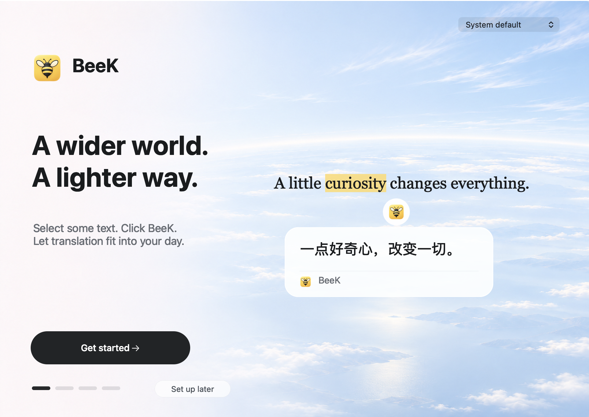

#  BeeK

Select text. Click the bee. Understand more.

A lightweight selection translator for macOS and Windows 11 x64.

Built with **Rust + GPUI**. Rust handles text selection, translation and background work; GPUI renders the bee button and translation cards, with native platform APIs providing system integration.

[简体中文](README.md)

**[Download for macOS](https://github.com/kaisersong/beek/releases/latest/download/BeeK.dmg)** · **[Windows installer](https://github.com/kaisersong/beek/releases/latest/download/BeeK-windows-x64-setup.exe)** · [Windows portable ZIP](https://github.com/kaisersong/beek/releases/latest/download/BeeK-windows-x64.zip) · [All releases](https://github.com/kaisersong/beek/releases)

  

**1.1.4 update:** Windows update checks use the public release page without depending on the anonymous GitHub API. Unclicked bee buttons hide after five seconds on both platforms. On macOS, CloudHub selections use the app's own Copy command to avoid missing or shifted characters, then restore the clipboard. [Release notes](RELEASE_NOTES.md). Download availability and build status are shown in [Releases](https://github.com/kaisersong/beek/releases) and [Actions](https://github.com/kaisersong/beek/actions).

| Feature | macOS | Windows 11 x64 |
| --- | --- | --- |
| Select text → click the bee → translate | Available | Available |
| Doubao translation and word explanations | Available | Available |
| Onboarding, bilingual UI, eight target languages | Available | Available in 1.1.2 |
| Multiple providers and configurable result cache | Available | Available in 1.1.2 |
| Distribution | Developer ID signed and notarized | Unsigned public preview |

## Translation cards and copying

An unclicked bee button hides after five seconds. A new selection starts a fresh timer, and hiding the button preserves any existing translation card.

Only AI dictionary results separate a complete pronunciation line into the header. Missing pronunciation has no placeholder, and ordinary translations keep their first line. Loading, errors and blank results do not overwrite the clipboard. You can copy text already received during streaming; dictionary copies include the source word and any available pronunciation. Speech reads the original word.

## Install

**macOS:** download `BeeK.dmg`, open it, and drag BeeK into Applications. Start BeeK and enable Accessibility when prompted. The released macOS app is signed and notarized. The versioned ZIP is used by the built-in updater.

**Windows:** run the installer and open BeeK from the Start menu. For the portable version, extract the whole ZIP and keep `beek.exe` together with its matching `beek-selection-host.exe`. Windows may show an unknown-publisher or SmartScreen warning. SHA256 checksums are included in the release. Full mixed-DPI/multiple-monitor acceptance is still pending. See the [Windows usage guide](packaging/windows/README-WINDOWS.txt).

## Start translating on macOS

The four-step onboarding covers welcome, selection gestures, service setup, and permissions with a trial translation. You can reopen it from **Getting started…** in the BeeK menu.

1. Enable BeeK under **System Settings → Privacy & Security → Accessibility**.
2. Choose a translation service. New macOS users can start with the shared Baidu service without a key.
3. Click **Try translation** to test the public sample. You do not need to select the sample text.
4. Select text in another app, then click the floating bee. A selection alone does not send a translation request.

**Doubao is recommended** for streaming translation and dictionary explanations. Create an API key in the [Volcengine Ark console](https://console.volcengine.com/ark/), enable your model, and enter the key and optional model/endpoint ID through onboarding or **Doubao API key…**. Calls use your own Ark account quota. Existing configurations keep their selected service and credentials.

For browser selection, BeeK may also request Automation permission. If you previously denied it, use **System Settings → Privacy & Security → Automation**. Other selection fallbacks remain available.

Most macOS apps use Accessibility text selection without touching the clipboard. CloudHub can report shifted text through that API, so BeeK reads its own Copy command instead and restores all clipboard types, including images. This workaround currently applies to CloudHub; it does not assume that every Electron app has the same issue.

## Translation services on macOS

Open **Translation service: …** to switch between shared Baidu, your own Baidu key, Doubao / OpenAI-compatible APIs, Azure Translator, Google Cloud Translation, MyMemory, or LibreTranslate / Argos. Each service keeps its own settings.

The shared Baidu service requires no key in the app, has limited shared quota, and accepts up to 1,500 UTF-8 bytes per request. Text is forwarded through the BeeK gateway to Baidu. Other hosted services use your own credentials and account quota. Dictionary explanations are provided by Doubao / OpenAI-compatible models; the other services return plain translations.

## Two independent language settings

- **App language:** system default, Simplified Chinese, or English. This changes the interface.
- **Translate to:** Simplified Chinese, English, Japanese, Korean, Traditional Chinese, French, German, or Spanish. This changes the translation request; the default is Simplified Chinese.

Both pickers are in the menu-bar menu and onboarding. Local services depend on installed language models; MyMemory requires an explicit source language.

## Result cache on macOS

All connected engines use a bounded, process-local cache. Successful complete results can be displayed immediately without another model or service request. Different providers, accounts, request settings, and target languages have separate cache identities.

Open **Translation cache…** to change the limits. Defaults are **128 entries / 30 minutes**; maximums are **1,000 entries / 24 hours / 2 MiB total**. Set either entry count or lifetime to zero to disable it. Cached results are cleared when BeeK exits.

## Local translation

LibreTranslate provides the API and Argos provides local models. BeeK includes an offline guide and a copyable AI setup prompt under **Translation service: … → LibreTranslate / Argos → Local installation guide…**. Copying instructions does not execute commands or install models.

- [Installation guide](resources/help/libretranslate-install.en.txt)
- [AI setup prompt](resources/help/libretranslate-agent-prompt.en.txt)

Use a loopback endpoint such as `http://127.0.0.1:5000/translate`. Install and verify the required source/target model pair with a public sample before enabling the service in BeeK.

## Updates

On macOS, **Check for updates…** immediately shows progress in a modeless window. Downloading and installing are separate choices, menus remain usable, and update notices preserve your Dock setting. Automatic checks can prepare updates in the background for installation on exit.

Windows can optionally check for updates automatically. Installation remains manual; download a newer package from [Releases](https://github.com/kaisersong/beek/releases).

See the [Chinese README](README.md) for source builds, configuration examples, selection internals, and development tools. Internal engineering documents are maintained in the separate mydocs repository; they are not required to build BeeK.

## Windows 1.1.2 preview

Windows 1.1.2 includes the same four-step onboarding composition as macOS,
using its horizon artwork, native interactive controls, service configuration and
explicit trial translation, plus Chinese/English/system UI language,
eight target languages, all seven translation providers and a configurable
memory cache. New users can start with free public Baidu translation; existing
Ark settings and credentials are preserved. Each service stores its own key in
Windows Credential Manager. Save settings with Ctrl+S; Try translation sends
only a public sample. Automatic update checks are optional; installation remains
manual. Upgrade to 1.1.2 for these additions; existing service settings and credentials are retained.
