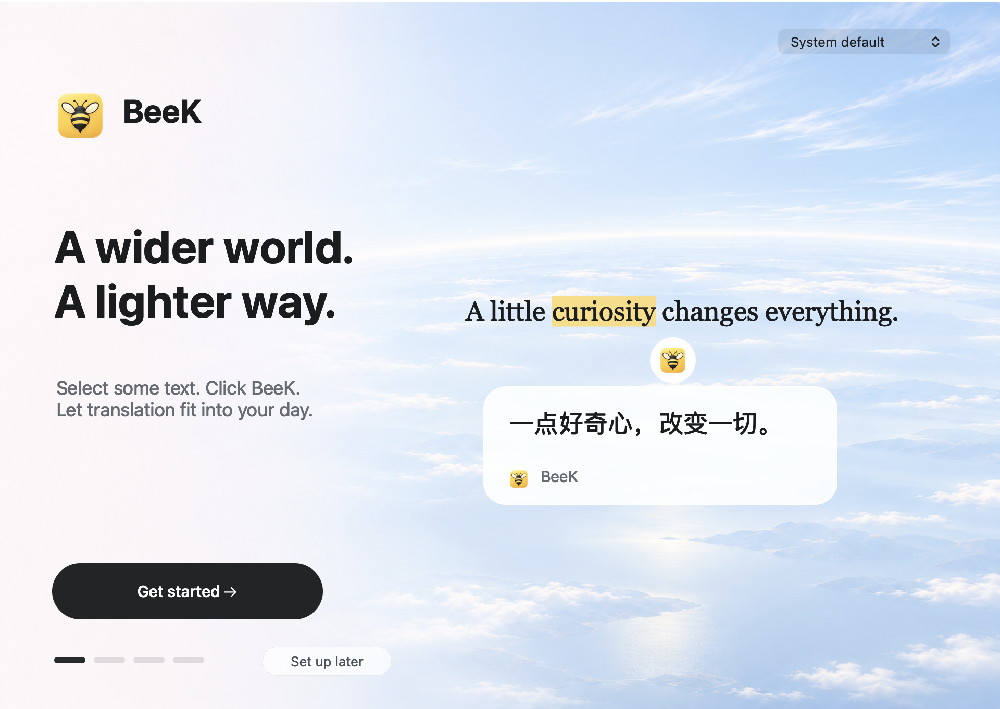

#  BeeK

Select text. Click the bee. Understand more.

A lightweight selection translator for macOS and Windows 11 x64.

Built with **Rust + GPUI**. Rust handles text selection, translation and background work; GPUI renders the bee button and translation cards, with native platform APIs providing system integration.

[简体中文](README.md)

[](https://github.com/kaisersong/beek/releases/latest)

**[Download for macOS](https://github.com/kaisersong/beek/releases/latest/download/BeeK.dmg)** · **[Windows installer](https://github.com/kaisersong/beek/releases/latest/download/BeeK-windows-x64-setup.exe)** · [Windows portable ZIP](https://github.com/kaisersong/beek/releases/latest/download/BeeK-windows-x64.zip) · [All releases](https://github.com/kaisersong/beek/releases)

Quick links: [Install](#install) · [Permissions](#permissions-macos) · [FAQ](#faq)

<p align="center">
  
</p>

**1.1.4 update:** Windows update checks use the public release page without depending on the anonymous GitHub API. Unclicked bee buttons hide after five seconds on both platforms. On macOS, CloudHub selections use the app's own Copy command to avoid missing or shifted characters, then restore the clipboard. [Release notes](RELEASE_NOTES.md). Download availability and build status are shown in [Releases](https://github.com/kaisersong/beek/releases) and [Actions](https://github.com/kaisersong/beek/actions).

| Feature | macOS | Windows 11 x64 |
| --- | --- | --- |
| Select text → click the bee → translate | Available | Available |
| Doubao translation and word explanations | Available | Available |
| Onboarding, bilingual UI, eight target languages | Available | Available in 1.1.2 |
| Multiple providers and configurable result cache | Available | Available in 1.1.2 |
| Distribution | Developer ID signed and notarized | Unsigned public preview |

## Translation cards and copying

An unclicked bee button hides after five seconds. A new selection starts a fresh timer, and hiding the button preserves any existing translation card.

Only AI dictionary results separate a complete pronunciation line into the header. Missing pronunciation has no placeholder, and ordinary translations keep their first line. Loading, errors and blank results do not overwrite the clipboard. You can copy text already received during streaming; dictionary copies include the source word and any available pronunciation. Speech reads the original word.

## Install

### macOS (3 steps)

1. **Download** **[BeeK.dmg](https://github.com/kaisersong/beek/releases/latest/download/BeeK.dmg)** (stable file name, always the latest release), or pick a specific `BeeK-v<version>.dmg` from [Releases](https://github.com/kaisersong/beek/releases).
2. **Install:** open the dmg and drag `BeeK` onto the `Applications` shortcut, then eject the disk image.
3. **Open:** double-click BeeK. Official releases are **Developer ID signed and Apple notarized**, so Gatekeeper lets them through — **no right-click → Open and no Terminal commands are needed**. First launch opens a four-step guide that ends with enabling Accessibility and a trial translation (see [Permissions](#permissions-macos)).

Optional verification: every asset ships a `.sha256` file — run `shasum -a 256 -c BeeK-v<version>.dmg.sha256`. The versioned ZIP next to the dmg is for the built-in updater, not for manual installation.

If macOS blocks the app, see the [FAQ](#faq).

### Windows 11 x64 (3 steps)

1. **Download** the [installer](https://github.com/kaisersong/beek/releases/latest/download/BeeK-windows-x64-setup.exe) or the [portable ZIP](https://github.com/kaisersong/beek/releases/latest/download/BeeK-windows-x64.zip). Windows builds are unsigned public previews; verify the published SHA256 first if you like.
2. **Install:** run the installer, or extract the **whole** ZIP and keep `beek.exe` together with its matching `beek-selection-host.exe` — the pair is verified at startup, so never mix files from different builds.
3. **First run:** SmartScreen / unknown-publisher prompts may appear — click **More info → Run anyway**. Then open BeeK from the Start menu.

Windows reads selections through system UI Automation and needs no macOS-style permission grants. Full mixed-DPI/multiple-monitor acceptance is still pending. See the [Windows usage guide](packaging/windows/README-WINDOWS.txt).

## Permissions (macOS)

BeeK needs **one required permission** (Accessibility) plus one optional grant (Automation) for browser selection. It does not capture the screen or log keyboard input, so **Screen Recording and Input Monitoring are not needed**. Windows needs none of this.

| Permission | Required? | Purpose |
| --- | --- | --- |
| Accessibility | Required | Read selected text in other apps and show the bee next to the selection |
| Automation (control browsers) | Optional | Ask Safari / Chrome directly for the selection without touching the clipboard; without it, BeeK falls back to the app's own Copy command / clipboard |

### 1. Accessibility (required)

1. Click the menu-bar bee → **Enable selection permission (Accessibility)…** to open the system panel directly. Equivalent command:

   ```bash
   open "x-apple.systempreferences:com.apple.preference.security?Privacy_Accessibility"
   ```

2. In **System Settings → Privacy & Security → Accessibility**: turn on BeeK if it is listed; otherwise click **+** and add `/Applications/BeeK.app`, then turn it on.
3. **No need to quit BeeK** — the grant takes effect automatically within about two seconds. If nothing happens, use **Restart BeeK** in the menu.

**Checked but still not working?** The list probably holds an entry for an old signing identity: remove the old BeeK entry with **−**, add it again, switch it on, then choose **Restart BeeK**. macOS ties Accessibility grants to the **signing identity**: updates between official releases (including the built-in updater) keep the grant; switching between local builds and official releases, or ad-hoc re-signing, requires granting once more.

**Verify:** select text in Notes — the bee should appear next to the selection; click it to translate. You can also reopen **Getting started…**; its last step includes a trial translation.

### 2. Automation (optional, browser selection)

In Safari / Chrome and other browsers, BeeK can read the selection via AppleScript without using the clipboard.

1. Open the browser you want to authorize (the picker only lists running browsers).
2. Click **Enable automation permission (control browser)…** in the BeeK menu, choose the browser, then click **Allow** in the system prompt.
3. Chromium browsers (Chrome / Edge / Brave / Arc) also need **View → Developer → Allow JavaScript from Apple Events**; without it BeeK falls back to the app's own Copy command.

**Previously clicked "Don't Allow"?** macOS will not ask a second time, and the Automation list **cannot be populated manually with +**. Click the menu item again: BeeK reports the denial and offers to open System Settings, where you can enable the browser under **Privacy & Security → Automation → BeeK**. Equivalent command:

```bash
open "x-apple.systempreferences:com.apple.preference.security?Privacy_Automation"
```

Without this grant BeeK still works through the app's own Copy menu item and the clipboard fallback (the clipboard is restored immediately after reading).

## Start translating on macOS

The four-step onboarding covers welcome, selection gestures, service setup, and permissions with a trial translation. You can reopen it from **Getting started…** in the BeeK menu.

1. Enable BeeK under **System Settings → Privacy & Security → Accessibility**.
2. Choose a translation service. New macOS users can start with the shared Baidu service without a key.
3. Click **Try translation** to test the public sample. You do not need to select the sample text.
4. Select text in another app, then click the floating bee. A selection alone does not send a translation request.

**Doubao is recommended** for streaming translation and dictionary explanations. Create an API key in the [Volcengine Ark console](https://console.volcengine.com/ark/), enable your model, and enter the key and optional model/endpoint ID through onboarding or **Doubao API key…**. Calls use your own Ark account quota. Existing configurations keep their selected service and credentials.

For browser selection, BeeK can request Automation permission from its menu: open the browser first, then choose **Enable automation permission (control browser)…** and click Allow in the system prompt. If you previously denied it, macOS will not ask again — BeeK then offers to open **System Settings → Privacy & Security → Automation**, where you can enable the browser manually. Other selection fallbacks remain available. Full steps are in [Permissions](#permissions-macos).

Most macOS apps use Accessibility text selection without touching the clipboard. CloudHub can report shifted text through that API, so BeeK reads its own Copy command instead and restores all clipboard types, including images. This workaround currently applies to CloudHub; it does not assume that every Electron app has the same issue.

## Translation services on macOS

Open **Translation service: …** to switch between shared Baidu, your own Baidu key, Doubao / OpenAI-compatible APIs, Azure Translator, Google Cloud Translation, MyMemory, or LibreTranslate / Argos. Each service keeps its own settings.

The shared Baidu service requires no key in the app, has limited shared quota, and accepts up to 1,500 UTF-8 bytes per request. Text is forwarded through the BeeK gateway to Baidu. Other hosted services use your own credentials and account quota. Dictionary explanations are provided by Doubao / OpenAI-compatible models; the other services return plain translations.

## Two independent language settings

- **App language:** system default, Simplified Chinese, or English. This changes the interface.
- **Translate to:** Simplified Chinese, English, Japanese, Korean, Traditional Chinese, French, German, or Spanish. This changes the translation request; the default is Simplified Chinese.

Both pickers are in the menu-bar menu and onboarding. Local services depend on installed language models; MyMemory requires an explicit source language.

## Result cache on macOS

All connected engines use a bounded, process-local cache. Successful complete results can be displayed immediately without another model or service request. Different providers, accounts, request settings, and target languages have separate cache identities.

Open **Translation cache…** to change the limits. Defaults are **128 entries / 30 minutes**; maximums are **1,000 entries / 24 hours / 2 MiB total**. Set either entry count or lifetime to zero to disable it. Cached results are cleared when BeeK exits.

## Local translation

LibreTranslate provides the API and Argos provides local models. BeeK includes an offline guide and a copyable AI setup prompt under **Translation service: … → LibreTranslate / Argos → Local installation guide…**. Copying instructions does not execute commands or install models.

- [Installation guide](resources/help/libretranslate-install.en.txt)
- [AI setup prompt](resources/help/libretranslate-agent-prompt.en.txt)

Use a loopback endpoint such as `http://127.0.0.1:5000/translate`. Install and verify the required source/target model pair with a public sample before enabling the service in BeeK.

## Updates

On macOS, **Check for updates…** immediately shows progress in a modeless window. Downloading and installing are separate choices, menus remain usable, and update notices preserve your Dock setting. Automatic checks can prepare updates in the background for installation on exit.

Windows can optionally check for updates automatically. Installation remains manual; download a newer package from [Releases](https://github.com/kaisersong/beek/releases).

See the [Chinese README](README.md) for source builds, configuration examples, selection internals, and development tools. Internal engineering documents are maintained in the separate mydocs repository; they are not required to build BeeK.

## FAQ

Installation and permission questions are collected here; for anything else, open an [issue](https://github.com/kaisersong/beek/issues) with the app name and your OS version.

**1. Do I need an API key?**
No. The default shared Baidu service works without a key (limited shared quota, up to 1,500 bytes per request). For streaming translation and dictionary explanations, bring your own Doubao / OpenAI-compatible key, or run LibreTranslate locally for fully on-device translation.

**2. macOS says the app "can't be opened", is from an "unidentified developer", or "is damaged"?**
Official releases are signed and notarized and open with a double-click — no right-click → Open or Terminal commands needed. If blocked, confirm you downloaded from this repository's [Releases](https://github.com/kaisersong/beek/releases) and that the file is complete (verify the `.sha256`; "damaged" usually means an incomplete download). Only local builds or third-party repackages need right-click → Open. Do not re-sign official packages: that changes the signing identity and invalidates both the Accessibility grant and notarization.

**3. Accessibility is enabled but selection still does nothing?**
Check in order: ① BeeK is running (bee icon in the menu bar); ② remove the old BeeK entry from the Accessibility list with −, re-add `/Applications/BeeK.app` and switch it on; ③ choose **Restart BeeK** in the menu; ④ try Notes or Chrome to rule out app-specific selection issues. Switching between local builds and official releases always requires granting once more. See [Permissions](#permissions-macos).

**4. No bee in my browser?**
Safari: make sure Automation is granted (menu item **Enable automation permission (control browser)…**). Chrome / Edge / Brave / Arc: also enable **View → Developer → Allow JavaScript from Apple Events**. Without either, BeeK falls back to the app's own Copy command / clipboard.

**5. The bee disappears after a few seconds?**
Expected: an unclicked button hides after five seconds; a new selection brings it back. Open translation cards are not affected.

**6. Windows shows an unknown publisher / SmartScreen prompt?**
Windows builds are unsigned public previews: click **More info → Run anyway**, and verify the release SHA256 if you like. Extract the portable ZIP completely and keep `beek.exe` with its matching `beek-selection-host.exe`. No macOS-style permission grants are needed on Windows.

**7. Is my selected text uploaded?**
A translation request is sent only **after you click the bee**; selecting text alone never contacts the network. Text goes to the service you chose: shared Baidu via the BeeK gateway, Doubao / Azure / Google through your own account, or LibreTranslate entirely on your machine. The result cache lives in memory and is cleared when BeeK exits.

**8. Will an update reset my permissions?**
Updates between official releases (including the built-in updater) keep the Developer ID signing identity, so the Accessibility grant survives. Only switching between local builds and official packages, or re-signing, requires granting again.

## Windows 1.1.2 preview

Windows 1.1.2 includes the same four-step onboarding composition as macOS,
using its horizon artwork, native interactive controls, service configuration and
explicit trial translation, plus Chinese/English/system UI language,
eight target languages, all seven translation providers and a configurable
memory cache. New users can start with free public Baidu translation; existing
Ark settings and credentials are preserved. Each service stores its own key in
Windows Credential Manager. Save settings with Ctrl+S; Try translation sends
only a public sample. Automatic update checks are optional; installation remains
manual. Upgrade to 1.1.2 for these additions; existing service settings and credentials are retained.
