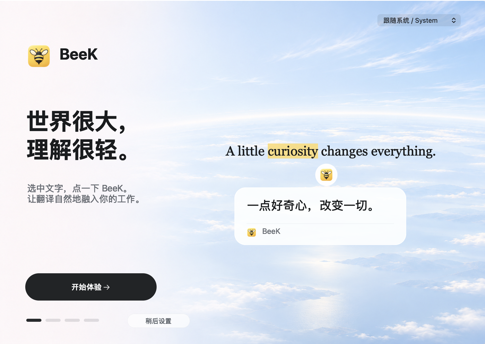

#  BeeK

世界很大，理解很轻。

在其他应用里选中文字，点一下小蜜蜂，译文就在身边。支持 macOS 和 Windows 11 x64。

BeeK 使用 **Rust + GPUI** 开发：Rust 实现取词、翻译与后台逻辑，GPUI 绘制蜜蜂按钮和翻译卡片，并通过各平台原生 API 接入系统功能。

[English](README.en.md)

[](https://github.com/kaisersong/beek/releases/latest)

**[下载 macOS 版](https://github.com/kaisersong/beek/releases/latest/download/BeeK.dmg)** · **[下载 Windows 安装包](https://github.com/kaisersong/beek/releases/latest/download/BeeK-windows-x64-setup.exe)** · [Windows 便携版](https://github.com/kaisersong/beek/releases/latest/download/BeeK-windows-x64.zip) · [所有版本](https://github.com/kaisersong/beek/releases)

<p align="center">
  
</p>

**1.1.4 更新**：Windows 更新检查改用公开发布入口，移除对 GitHub 匿名 API 的依赖；两平台的蜜蜂按钮未点击时，显示 5 秒后自动隐藏；macOS 修复云之家选区漏字、错位的问题，通过应用自身拷贝读取完整选区并还原剪贴板。[查看更新说明](RELEASE_NOTES.md)。下载产物与构建状态以 [Releases](https://github.com/kaisersong/beek/releases) 和 [Actions](https://github.com/kaisersong/beek/actions) 为准。

| 功能 | macOS | Windows 11 x64 |
| --- | --- | --- |
| 选中文字 → 点击蜜蜂 → 翻译 | 支持 | 支持 |
| 豆包翻译、单词详解 | 支持 | 支持 |
| 使用引导、中英文界面、8 种目标语言 | 支持 | 支持（1.1.2） |
| 多翻译服务、近期结果缓存及设置 | 支持 | 支持（1.1.2） |
| 分发 | Developer ID 签名并公证 | 未签名公开预览 |

Windows 安装后从开始菜单打开 BeeK；便携版请完整解压，保留 `beek.exe` 同目录的 `beek-selection-host.exe`。系统可能显示未知发布者提示，可核对 Release 的 SHA256 文件。完整多屏 / 混合 DPI 验收仍待完成。[Windows 安装与使用说明](packaging/windows/README-WINDOWS.txt)

## Windows 使用（1.1.2）

首次打开使用与 macOS 同一视觉布局的四步引导：欢迎 → 体验划词 → 连接翻译服务 → 试译并开始使用。使用同一云海背景和品牌图标，可随时返回上一步或从设置 / 托盘重开。在引导中保存服务后自动回到试译页。默认百度公共服务免 Key，也可切换豆包 / OpenAI 兼容、Azure、个人百度 Key、Google、MyMemory 或本地 LibreTranslate / Argos；各服务的配置和凭据独立保留。界面支持跟随系统、简体中文和 English；翻译目标支持 8 种语言。保存后生效，`Ctrl+S` 可快速保存；“点击试译”发送固定公开例句。

缓存默认 128 条、30 分钟，仅保存在当前进程，条数或分钟设为 0 可关闭。两种百度服务不缓存。托盘可重开引导、预览剪贴板和检查更新；自动检查更新可开关，安装仍需手动完成。升级到 1.1.2 可使用上述能力；从旧版升级会保留已有服务配置与凭据。

## 翻译卡片与复制

蜜蜂按钮出现后，5 秒内未点击会自动隐藏；重新划词会重新计时。按钮隐藏不会关闭已有的译文卡片。

只有豆包 / OpenAI 兼容的单词详解会将完整的读音首行移到标题中；没有读音时不显示占位，普通译文的第一行完整保留。加载中、错误和空白结果不会覆盖剪贴板；流式翻译中可复制当前已收到的内容，词典结果会附原词和可用读音。朗读仍读原词。

## 特性（macOS）

- **取词优先走 AX**：多数应用（备忘录、Chrome、终端、访达等）通过 macOS 辅助功能接口读选中文本，不用按键、不碰剪贴板。云之家可能返回错位的 AX 文本，因此优先读取它自身“拷贝”命令的结果，随后整体还原剪贴板（含图片）。
- **AX 取不到时有两种兜底**（都在菜单里，可自行开关）：「剪贴板兜底取词」= 划词手势后 BeeK 自动模拟一次 ⌘C 去读（读完立即整体还原剪贴板，**默认开**）；「复制即弹按钮」= 你自己按 ⌘C 时在鼠标旁弹图标（**默认关** —— 它会在每次复制时弹，常复制的人会被打扰，只有 Safari、Muse、Grok Bot 这类应用才值得打开）。
- **点击才翻译**：出现图标时不请求；点击图标才发请求。
- **豆包支持词典式详解**：使用豆包 / OpenAI 兼容引擎且选中单个词时，输出读音、词性与释义、例句、常见搭配。标题行有喇叭图标，点击用系统语音朗读该词。
- **弹窗可拖动**：按住卡片顶部拖动条可以移动弹窗。
- **点外部关闭**：在弹窗外面按一下鼠标就关闭弹窗。
- **服务可切换**：百度公共服务免 Key，也可保存自己的服务配置；各引擎配置独立保留。

## 安装（macOS）

### 方式 A：下载 Release

1. 直接点上面的 **[下载最新版 BeeK.dmg](https://github.com/kaisersong/beek/releases/latest/download/BeeK.dmg)**；
   想挑特定版本就去 [Releases](https://github.com/kaisersong/beek/releases) 下对应的 **`BeeK-v<版本>.dmg`**。
2. 双击挂载，把 `BeeK` 拖到 `Applications` 快捷方式上（或拖进「应用程序」）。
3. 卸载磁盘映像，双击打开 BeeK 即可 —— 已用 Developer ID 签名并公证，**不需要右键 → 打开**。

旁边的 `BeeK-v<版本>.zip` 是给内置更新器用的（`检查更新…` 会按这个名字找升级包），手动安装不需要它。
每个资产都配了 `.sha256`，想校验就 `shasum -a 256 -c BeeK-v<版本>.dmg.sha256`。

### 方式 B：本地构建

```bash
git clone https://github.com/kaisersong/beek.git
cd beek
sh scripts/package_app.sh
```

`scripts/package_app.sh` 按顺序做五件事：`cargo build --release`、停掉旧进程、组装 `/Applications/BeeK.app`、重新签名、启动 LaunchAgent。

需要 `rust-toolchain.toml` 指定的 Rust 1.99.1，以及带有 Metal 编译工具的 Xcode。

## 获取 API Key

推荐使用豆包：支持流式翻译和单词详解，需要你自己的火山方舟 API Key，调用使用该账号额度。macOS 和 Windows 新用户均可先使用默认的百度公共服务，无需 Key；已有豆包设置和凭据会保留。

1. 打开方舟控制台：<https://console.volcengine.com/ark>。
2. 完成实名认证。新账号需要这一步。
3. 在控制台左下角选择项目空间。这一步可选。
4. 进入「API Key 管理」，点「创建 API Key」。
5. 在弹框里确认或修改名称，点创建。
6. 在「API Key 管理」的列表里复制这个 Key。
7. 在「开通管理」里确认要用的模型已开通。默认模型是 `doubao-seed-2-0-mini-260428`。
8. 如果该模型要求推理接入点（Endpoint）：在控制台的「在线推理」页面创建接入点，把接入点 ID 填进配置的 `model` 字段。接入点 ID 可以直接当模型名用。

官方文档：[获取 API Key 并配置](https://www.volcengine.com/docs/82379/1541594)。

拿到 Key 后，点菜单栏的蜜蜂图标 → 「豆包 API Key…」。菜单项「如何获取 API Key…」会打开本节的 GitHub 页面（锚点 `#获取-api-key`）。

## 首次使用引导（macOS）

首次启动会打开四步引导：欢迎 → 了解划词用法 → 添加模型服务 → 开启辅助功能并试译。重点推荐豆包：在火山方舟创建 API Key、开通模型并复制 Model ID / 接入点 ID，然后从引导直接填写并启用。也可先用免 Key 的百度公共服务，已有服务选择与凭据会保留。

引导中的“点击试译”只在点击后发送公开例句；重复试译命中缓存时直接显示“缓存命中”。完成或“稍后设置”后不再自动弹出，菜单栏、应用菜单及 Dock 的“使用引导…”可随时重开。关闭窗口但未完成时，下次启动仍可继续了解。缓存只在当前 BeeK 进程内保存，退出后清空；翻译卡片命中时也会标注“缓存”。

## 可切换翻译服务（macOS）

初次使用默认选择「百度翻译（免费公共服务）」，无需填写 Key；点击翻译后选区经 BeeK 公共网关转发给百度，共享额度有限（单次最多 1500 字节）。菜单栏 BeeK →「翻译服务：…」可切换「百度翻译（自己的 Key）」、豆包 / OpenAI 兼容、Azure、Google、MyMemory 或 LibreTranslate / Argos，再填写相关字段并保存启用。已有引擎选择与个人凭据会保留。每家的配置独立保留，所有引擎统一使用本机结果缓存，并按引擎、账号和请求设置隔离；单词详解由豆包 / OpenAI 兼容引擎提供，其余服务返回普通译文。Windows 可在引导或设置中选择这些服务。

本地开源方案使用 LibreTranslate 提供 API、Argos 提供翻译模型，首次准备模型需联网。打开 LibreTranslate 配置中的「本地安装说明…」即可离线查看 Docker / Python 安装命令、启动停止与排错，并「复制 AI 安装提示词」交给能操作终端的助手。复制不会自动执行安装。

- [本地服务安装说明](resources/help/libretranslate-install.txt)
- [给 AI 助手的快速安装提示词](resources/help/libretranslate-agent-prompt.txt)

服务就绪后填写 `http://127.0.0.1:5000/translate`，默认不需要 Key。先用说明中的公开短句验证，再保存启用。BeeK 本身不会自动安装模型或启动服务。

## 语言与缓存（macOS）

- 菜单「翻译为：…」独立选择简体中文、英文、日文、韩文、繁体中文、法文、德文或西班牙文；默认简体中文。所有已接入引擎按所选目标发起请求。LibreTranslate 需安装对应语言模型，MyMemory 需明确源语言。
- 菜单「界面语言：…」选择跟随系统、简体中文或 English，只改变 BeeK 界面；不会改变翻译目标。引导页也有语言选择。
- 「翻译缓存设置…」默认128条、30分钟；条数或时效设为0可关闭，最多1000条、24小时、总计2MiB。只缓存完整成功结果，按引擎、账号、请求设置和目标语言隔离；命中直接展示，退出 BeeK 后清空。

## 配置（macOS）

以下为豆包配置方式，配置文件优先；其他服务在「翻译服务：…」中分别保存：

1. 菜单「豆包 API Key…」，写入 `~/Library/Application Support/BeeK/config.json`。**优先使用。**
2. 环境变量 `BEEK_ARK_KEY`。作为兜底。

`config.json` 豆包示例（请替换占位符，不要把真实 Key 提交到 Git）：

```json
{
  "show_in_dock": false,
  "translation_engine": "ark",
  "translation_target": "zh-CN",
  "ui_language": "system",
  "translation_cache": { "max_entries": 128, "ttl_minutes": 30 },
  "providers": {
    "ark": {
      "api_key": "your-ark-api-key",
      "model": "doubao-seed-2-0-mini-260428"
    }
  }
}
```

- `show_in_dock`：是否在 Dock 显示图标。菜单「在 Dock 中显示」改这个字段。
- `providers.ark.api_key`：方舟 API Key。
- `providers.ark.model`：可选。不填就用默认模型 `doubao-seed-2-0-mini-260428`。
- `translation_target` 与 `ui_language` 分别控制翻译目标和界面语言；`translation_cache` 控制缓存条数与时效。
- `providers.ark.base_url`：可选。不填就用方舟默认地址；填了就请求这个 OpenAI 兼容端点（例如自建网关）。

## 取词方式（macOS）

BeeK 通常按下面的顺序取选中文本，前一条拿不到才走后面。云之家因 AX 文本可能错位，直接优先采用第 3 条的应用自身拷贝结果；其他 Electron 应用仍使用各自有效的路径。这套顺序参考了开源实现
[SelectedTextKit](https://github.com/tisfeng/SelectedTextKit)（Easydict 的取词组件），
并对照豆包的二进制（`libaha_cua.dylib` 导入 `AXUIElementCopyElementAtPosition`、
`AXObserverAddNotification`、`CGEventTapCreate`）确认过思路。

| 顺序 | 路径 | 适用 | 代价 |
| --- | --- | --- | --- |
| 1 | **AX 取词**：按鼠标坐标取元素，读它的 `AXSelectedText` | 备忘录、Chrome、终端、访达等 | 无（默认路径） |
| 2 | **浏览器 AppleScript**：`window.getSelection().toString()` | Safari 开箱可用；Chrome / Edge / Brave / Arc 需要先在该浏览器里开「查看 → 开发者 → 允许 Apple 事件中的 JavaScript」 | 首次需授权「控制浏览器」；不碰剪贴板。Chromium 系没开那个开关会自动回退到第 3 条 |
| 3 | **菜单拷贝**：在目标应用菜单栏里找到「拷贝」项并按下（`AXPress`），让**应用自己**执行拷贝 | 云之家优先使用；其他应用在 AX 不可用时采用，含 Muse、Grok Bot 等 | 短暂占用剪贴板（读完立即还原） |
| 4 | **复制即弹按钮**（默认关）：你自己按 ⌘C 时弹按钮，AX 已有选区时不弹 | 任何应用，兜底用 | 多按一次 ⌘C；每次复制都可能弹，故默认关 |
| 5 | **剪贴板兜底**（可关）：自动合成一次 ⌘C 去取 | 时灵时不灵，最后手段 | 短暂占用剪贴板 |

说明：

- 第 3 条是这套方案能覆盖 Electron / Safari 的关键。合成 ⌘C（第 5 条）在很多应用上**收不到**，
  而「按它自己的拷贝菜单项」是让应用自己执行拷贝，不依赖它是否响应合成按键。
  菜单项定位规则：`AXIdentifier` 恰为动作 selector `copy:`，**或**标题在拷贝标题表（多语言）
  且（若暴露）快捷键字符为 C。菜单搜索先看第 4 个菜单（通常是「编辑」），再左右交替展开。
- 第 3、5 条都会先备份剪贴板、读完立刻整体还原（含图片等非文本内容）。
- 排查某个应用「划词弹不出」时，用探针看它到底暴露了什么：

```bash
# 看某应用的 AX 选区情况（在目标应用里选好文字后跑）
BEEK_AX_PROBE=1 BEEK_AX_PROBE_PID=$(pgrep -x Safari | head -1) /Applications/BeeK.app/Contents/MacOS/BeeK

# 看菜单结构（确认「拷贝」项长什么样）
BEEK_MENU_DUMP=1 BEEK_APPCOPY_SELFTEST=1 /Applications/BeeK.app/Contents/MacOS/BeeK

# 在用户划词的那一刻报告 AX 现场（装 CGEventTap）
BEEK_AX_WATCH=1 /Applications/BeeK.app/Contents/MacOS/BeeK
```

监听默认 120 秒后退出，`BEEK_AX_WATCH_SECONDS` 可设为 1–3600 秒。
排查长时间运行后的内存增长时，可用不读取用户文本的原生测试窗口复测：

```bash
cargo test --bin beek --lib
python3 scripts/check_macos_memory.py
# 可选：与修复前的版本对照
python3 scripts/check_macos_memory.py --baseline-ref ae7713f
```

## 权限（macOS）

取词依赖辅助功能权限。

1. 系统设置 → 隐私与安全性 → 辅助功能 → 勾选 BeeK。
2. 也可以点菜单「开启取词权限（辅助功能）…」，直接跳到该面板。等价的命令：

```bash
open "x-apple.systempreferences:com.apple.preference.security?Privacy_Accessibility"
```

**浏览器取词还有第二条路要授权**：Safari / Chrome 等会通过 AppleScript 问浏览器要选区，
第一次会弹「BeeK 想要控制 Safari」。点了「不允许」的话系统**不会**再问，需要到
系统设置 → 隐私与安全性 → **自动化** → BeeK 里手动勾上（菜单里有「开启自动化授权（控制浏览器）…」直达）。
这条不授权也能用：取词会继续走「按应用自己的拷贝菜单项」和剪贴板兜底，只是多占一下剪贴板。

改完权限后如果取词没有反应，点菜单「重新启动 BeeK」。

**注意**：macOS 把辅助功能授权记在签名身份上。换一个身份签名，授权就失效，需要重新勾选一次。`scripts/package_app.sh` 优先用钥匙串里的 Apple Development 证书签名，授权因此能跨更新保留；找不到证书时它退回 ad-hoc 签名，这种情况下每次更新都要重新勾选。

## 更新

菜单「检查更新…」：

- 点击后立即显示检查进度，结果窗口不锁住菜单，也不改变 Dock 显示设置；重复点击不会重复发起手动检查。
- 有新版本时显示说明，点「下载并更新」准备 `BeeK-v<版本>.zip`；下载完成后另点「立即更新」才退出并切换应用，然后重启。
- 已是最新时，只提示当前版本。

手动更新有两种方式：下载 zip 后替换 `/Applications/BeeK.app`；或者拉最新代码后运行 `sh scripts/package_app.sh`。

更新后如果取词失效，按上一节重新勾选辅助功能。

## 菜单（macOS）

| 菜单项 | 作用 |
| --- | --- |
| BeeK 划词翻译 v<版本> | 显示版本，不可点击 |
| 开启取词权限（辅助功能）… | 打开系统的辅助功能面板 |
| 开启自动化授权（控制浏览器）… | 打开系统的「自动化」面板。浏览器取词那条 AppleScript 路径第一次会问一次，**当时点了「不允许」就不会再弹**，只能来这里勾上；不勾也能取词（会走菜单拷贝 + 剪贴板兜底） |
| 在 Dock 中显示 | 切换 Dock 图标，勾选项 |
| 豆包 API Key… | 配置豆包 / OpenAI 兼容服务的 Key、模型与地址 |
| 使用引导… | 重新打开四步引导 |
| 翻译服务：… | 选择服务并保存该服务的配置 |
| 翻译为：… | 选择译文目标语言 |
| 界面语言：… | 跟随系统，或切换简体中文 / English |
| 翻译缓存设置… | 配置缓存条数、时效或关闭缓存 |
| 如何获取 API Key… | 打开本仓库 README 的「获取 API Key」一节。这一项左边是圆圈 i 图标，见「图标」一节 |
| 复制即弹按钮（自己按 ⌘C） | 勾选项，**默认不勾**。勾上后你自己按 ⌘C 时在鼠标旁弹出小蜜蜂（AX 已有选区时不弹） |
| 剪贴板兜底取词 | 勾选项。AX 取不到选区时，BeeK 自动模拟一次 ⌘C 去读选中文本 |
| 自动检查更新 | 勾选项，**默认勾**。启动 10 秒后检查一次、之后每 6 小时一次；后台下载完**不打断你**，只把下面那项改成「更新到 vX（退出后生效）」，退出 BeeK 时静默装上，下次启动即新版本 |
| 检查更新… | 手动检查；若后台已下载好，这里会显示成「更新到 vX（退出后生效）」，点了可以直接重启更新 |
| 关于 BeeK | 显示版本信息，可跳 README 或 GitHub |
| 重新启动 BeeK | 重启进程。改完权限后用 |
| 退出 BeeK | 退出进程、卸载 LaunchAgent 并删除其 plist（下次登录不会再自己起来）。如果后台已经下载好更新，会顺便静默装上 |

Dock 图标（菜单「在 Dock 中显示」打开后才有）：

- **右键**：弹出同一套动作（豆包 API Key / 翻译服务 / 如何获取 API Key / 取词权限 / 检查更新 / 关于 / 重新启动 / 退出）。
  这份菜单走的是 gpui 的 `set_dock_menu` —— macOS 是通过 `applicationDockMenu:` 这个委托方法要 Dock 菜单的，
  手写挂在 `NSApp.dockMenu` 上会被 gpui 自己的 delegate 挡住。
- **左键**：macOS 发出「重新打开」（`applicationShouldHandleReopen`）。
  BeeK 的处理是把菜单栏那份菜单弹出来（等于点菜单栏图标），不会出现「点了没反应」。
- 顶部菜单栏（app 激活时）：app 菜单（关于 / 检查更新 / 豆包 API Key / … / 退出）+ 编辑菜单。
  「编辑」这一项是手搓的，因为 gpui 的 delegate 自己实现了 `copy:`/`paste:`，用 gpui 的菜单项
  会让动作发给 delegate 而不是文本框，对话框里的 ⌘V 就废了。

更新进度和结果使用非模态窗口，保持用户的 Dock 显示设置。部分设置及关于对话框仍会临时激活应用，关闭后恢复原策略；不改写 `config.json` 的 Dock 偏好。

版本号来自 `Cargo.toml` 的 `version`。

## 开发文档

`docs` 按 xiaok 的方式链接到同级文档仓库的 `mydocs/beek/`。设计、评审与故障记录在 mydocs 维护；单独检出代码仍可构建和打包，阅读内部文档需要同时检出 mydocs。

- [文档索引](https://github.com/kaisersong/mydocs/blob/master/beek/README.md)
- [系统设计与平台边界](https://github.com/kaisersong/mydocs/blob/master/beek/design/system-design.md)
- [原生资源与后台任务规则](https://github.com/kaisersong/mydocs/blob/master/beek/reliability/native-resource-lifecycle.md)
- [2026-10-29 内存泄漏复盘](https://github.com/kaisersong/mydocs/blob/master/beek/reliability/2026-10-29-macos-native-memory-leak.md)
- Windows：[构建与测试](https://github.com/kaisersong/mydocs/blob/master/beek/windows/build-and-test.md)、[实施状态](https://github.com/kaisersong/mydocs/blob/master/beek/windows/implementation-status.md)、[完整测试方案](https://github.com/kaisersong/mydocs/blob/master/beek/windows/windows-test-plan.md)

## 图标

下面是 app 实际在用的图标（`resources/icons/` 里就是这些文件，不是另画的示意图）。
菜单栏和菜单项的图标是 template 图（纯黑 + alpha，由系统按明暗自动反色），
所以每种给两张：黑的那张跟着浅色主题，白的那张跟着深色主题。

- **应用图标**（Dock / Finder / 关于窗口）： — `BeeK.icns`
- **菜单栏图标**：<picture><source media="(prefers-color-scheme: dark)" srcset="resources/icons/BeeKMenuBarTemplate-white@2x.png"></picture> — `BeeKMenuBarTemplate@2x.png`
- **划词后出现在选区旁的小蜜蜂**： — `beek-selection-{default,hover,pressed,disabled}-32@2x.png`
- **弹窗标题行的喇叭**（点它朗读单词）： — `beek-speak-outline@4x.png`
- **菜单「如何获取 API Key…」左侧的圆圈 i**：<picture><source media="(prefers-color-scheme: dark)" srcset="resources/icons/beek-circle-i-white@4x.png"></picture> — `beek-circle-i@4x.png`

其中三个是脚本生成的，改图标时改脚本而不是描点补图：
`gen_circle_i.py`（圆圈 i）、`gen_speak_outline.py`（喇叭）、
`gen_template_white.py`（由 template 图生成上面那两张白色版本，供 README 用）。

## 发布

两条路，产物结构一致（都走 `scripts/build_bundle.sh` 组装），区别只在签名和公证：

| | 本地 `sh scripts/release.sh --publish` | CI（`.github/workflows/release.yml`） |
| --- | --- | --- |
| 签名 | 本机钥匙串里的 Apple Development | Developer ID Application（repo secrets 里的 .p12） |
| 公证 | 不做 | 做（app 和 DMG 都 `notarytool` + `stapler staple`） |
| 产物 | 只有 `BeeK-v<版本>.zip` | `BeeK-v<版本>.dmg`（给用户装）+ `BeeK-v<版本>.zip`（给内置更新器）+ 两个 `.sha256`，外加一份稳定命名的 `BeeK.dmg`（README 的「下载最新版」指向它，永远不会因版本号过期） |
| 用户下载后 | Gatekeeper 判 `rejected`，要右键 → 打开 | DMG / app 都是 `accepted`，双击即可 |
| 适用 | 自己用、临时验证 | 对外发布 |
| 授权保留 | 同一身份，辅助功能授权跨更新保留 | 换成 Developer ID 身份，**第一次要重新勾选一次**辅助功能（之后就稳定，且 Developer ID 有效期 5 年） |

CI 触发方式：

- 手动：Actions → Release → Run workflow（`publish=false` 只构建 + 签名 + 公证，产物在 artifact 里，先验证再发）
- 推送与 `Cargo.toml` 版本一致的 `v<版本>` 标签 → 自动发布到 Release（先建草稿、传完资产再转正式）

CI 需要的 repo secrets（**值只能由仓库所有者添加**）：

| secret | 内容 |
| --- | --- |
| `MACOS_CERTIFICATE_P12_BASE64` | Developer ID Application 证书导出的 .p12，base64 |
| `MACOS_CERTIFICATE_PASSWORD` | 上面那个 .p12 的密码 |
| `APPLE_TEAM_ID` | 团队 ID（`Y9YR86UG94`，工作流会校验） |
| `APPLE_API_KEY_ID` | App Store Connect API Key 的 Key ID |
| `APPLE_API_ISSUER` | 该 Key 的 Issuer ID |
| `APPLE_API_KEY_P8_BASE64` | `AuthKey_<KEY_ID>.p8` 文件内容，base64 |

签名证书：Developer ID Application，**2027-11-15 到期**（Apple 现在只发一年期）。到期或换机时的重做流程：
本机 `scripts/dev/make_developer_id_cert.py` 生成 CSR（私钥留在 `~/.xiaok/apple-signing/`）→
账号持有人本人在开发者后台用它签发 Developer ID Application 证书（API 不行，实测被 403 挡）→
下载 .cer → 同一个脚本 `--from-cer` 打包成 p12（用 `-legacy`，Security.framework 不认 OpenSSL 3 的
默认 AES 格式）→ 重新写那 6 个 secrets。脚本打完包会自己用 CI 那条 `security import` 命令验一遍。

签名用的 entitlements 在 `resources/BeeK.entitlements`：hardened runtime 下必须有
`com.apple.security.automation.apple-events`，否则浏览器那条 AppleScript 取词路径会被系统直接拒掉。

更新已装好的 app 时，如果新包本来就是 Developer ID 签名（CI 出的），`install_script` 会
**保留原签名**（不重签）：重签会换身份、让辅助功能和公证一起失效。

## 架构

- `src/main.rs` — 平台入口分发
- `src/macos_main.rs` — macOS 图标窗口、翻译卡片与主循环
- `src/ax.rs` — AX 取词：多层回退读取选中文本与选区矩形
- `src/appcopy.rs` — 让目标应用自己交选区：浏览器 AppleScript、按下它自己的「拷贝」菜单项
- `src/translate.rs` — 豆包流式翻译、多服务调度与统一缓存；单词详解由豆包 / OpenAI 兼容引擎提供
- `src/menubar.rs` — 菜单栏状态项与菜单
- `src/config.rs` — 配置持久化
- `src/clipboard.rs` — 模拟 ⌘C、剪贴板整体备份/还原、剪贴板监听
- `src/eventtap.rs` — CGEventTap 全局事件监听（划词时机、鼠标按键）
- `src/dialogs.rs` — 服务配置、缓存设置与关于对话框
- `src/onboarding.rs` — 四步原生引导与公开例句试译
- `src/update_ui.rs` — 非模态更新进度与结果
- `src/core/translation_engine.rs` — 翻译服务协议
- `src/core/localization.rs` — 中英文消息目录
- `src/icons.rs` — 编译期内嵌图标素材
- `src/update.rs` — 检查更新、下载与替换 App
- `src/mouse.rs` — 全局鼠标状态，供拖动弹窗与「点外部关闭」使用

## 开发

自检开关都是环境变量：

| 变量 | 作用 |
| --- | --- |
| `BEEK_DEBUG=1` | 详细日志：AX 取值、流式响应、弹窗高度度量 |
| `BEEK_SELFTEST=1` | 注入模拟选区，跑完「取词 → 图标 → 弹窗」链路。不需要辅助功能权限 |
| `BEEK_TRANSLATE_SELFTEST=1` | 只量接口耗时，不开窗口 |
| `BEEK_CLIP_SELFTEST=1` | 验证「模拟 ⌘C + 剪贴板还原」两个原语（先在别的应用里选好一段文字） |
| `BEEK_APPCOPY_SELFTEST=1` | 验证「让应用自己交选区」两条路（AppleScript / 拷贝菜单项） |
| `BEEK_MENU_DUMP=1` | 配合上一条，把目标应用的菜单结构打出来 |
| `BEEK_AX_PROBE=1` + `BEEK_AX_PROBE_PID=<pid>` | 看某个应用的 AX 选区情况 |
| `BEEK_AX_WATCH=1` | 装 CGEventTap，在用户划词的那一刻报告 AX 现场；默认 120 秒后退出，`BEEK_AX_WATCH_SECONDS` 可设为 1–3600 秒 |
| `BEEK_UPDATE_CHECK=1` | 跑一次「检查更新」并打印结果 |
| `BEEK_UPDATE_PREPARE=<zip 地址>` | 配合上一条，把「下载 → 解压」也跑一遍（不碰 /Applications） |
| `BEEK_UPDATE_APPLY=1`（可用 `BEEK_UPDATE_SELFTEST_URL=<zip 地址>` 换源） | 端到端：检查 → 下载 → 解压 → 生成替换脚本 → 退出自己 |
| `BEEK_UPDATE_FEED=<atom 地址>` + `BEEK_UPDATE_ASSET=<zip 地址>` | 把「检查更新」指到本地假 feed / 本地 zip，不发版也能验证自动更新整条链路 |
| `BEEK_UPDATE_SCRIPT_DUMP=1` | 在临时目录下的独立 `beek-update-*` 目录生成两种安装脚本（立即更新 / 静默安装），输出具体路径便于对比 |
| `BEEK_QUIT_TEST=1` | 走一遍真实退出路径（`launchctl bootout` + 删 plist + 可能的静默安装） |
| `BEEK_ABOUT_ON_START=1` | 启动后自动弹一次「关于」，用来观察只跟「激活状态 / 模态框」有关的行为 |
| `BEEK_DIALOG_AUTOCLOSE=1` | 对话框 2 秒后自动「按好」关掉，不用手点也能验证关框之后的行为 |
| `BEEK_ARK_KEY` | 翻译用的 API Key（配置文件的兜底） |

```bash
cargo build --release
BEEK_SELFTEST=1 BEEK_DEBUG=1 ./target/release/beek
```

运行日志在 `/tmp/beek.log`。

## 许可

MIT License，见 [LICENSE](LICENSE)。Copyright (c) 2026 Kaiser。
